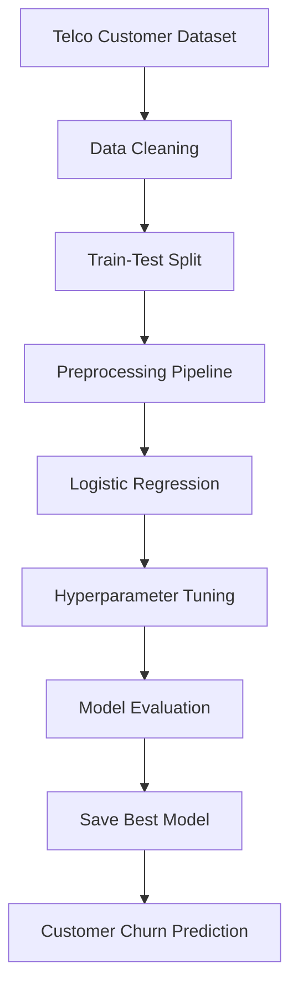
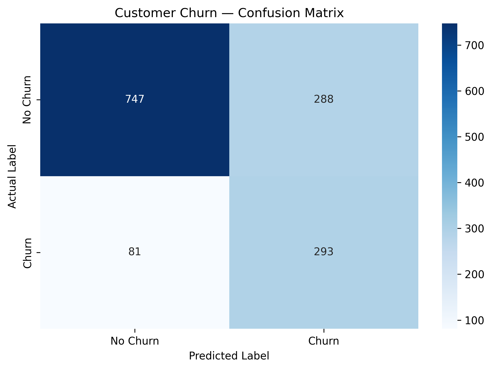

# 📊 Customer Churn Prediction

### Machine Learning | Telco Customer Analytics

<p align="center">
  <strong>Turning customer data into actionable insights for better customer retention.</strong>
</p>

<p align="center">
  
  
  
  
  
</p>

<p align="center">
  
  
  
</p>

---

## 🎯 Overview

Customer churn occurs when customers stop using a company's services. Predicting potential churn can help businesses identify customers who may leave and make more informed retention decisions.

This project applies **Machine Learning to the Telco Customer Churn dataset** to analyze customer information, preprocess data, train a Logistic Regression classifier, and evaluate model performance before and after hyperparameter tuning.

## ✨ Key Features

- 📂 Dataset loading and data quality checks
- 🔍 Exploratory Data Analysis (EDA)
- 🧹 Missing-value handling and feature preprocessing
- 🔢 Numerical feature scaling and categorical encoding
- 🤖 Logistic Regression classification
- ⚙️ Hyperparameter tuning using `GridSearchCV`
- 📊 Accuracy, precision, recall, F1-score, and confusion matrix evaluation
- 💾 Model export for reuse through `joblib`

## 📁 Dataset

**Dataset:** Telco Customer Churn  
**Source:** [Kaggle — Telco Customer Churn](https://www.kaggle.com/datasets/blastchar/telco-customer-churn)

The dataset contains customer demographics, subscribed services, account details, billing information, and churn status.

| Attribute | Description |
|---|---|
| Input features | Customer, service, account, and billing information |
| Target variable | `Churn` |
| Prediction task | Binary classification |
| Target classes | `Yes` — churned; `No` — did not churn |

> The dataset is not included in this repository. Download it from Kaggle and place the CSV file in the required `data/` directory to run `src/train.py`.

## 🔄 Project Workflow



## 📈 Model Performance

The original notebook reports the following accuracy scores:

| Model | Accuracy |
|---|---:|
| Original Logistic Regression | 73.81% |
| Tuned Logistic Regression | 73.81% |

**Key observation:** Hyperparameter tuning did not change the reported accuracy in this experiment.

Accuracy alone is not enough to assess churn prediction. Recall, precision, F1-score, and the confusion matrix provide additional insight into how effectively the model identifies customers who churn.

### Confusion Matrix



## 🛠️ Tech Stack

| Technology | Purpose |
|---|---|
| Python | Programming language |
| Pandas | Data manipulation and analysis |
| NumPy | Numerical operations |
| Scikit-learn | Preprocessing, classification, and model evaluation |
| Matplotlib | Data visualization |
| Seaborn | Statistical visualization, if used |
| Joblib | Saving and loading trained models |
| Jupyter Notebook | Interactive analysis and experimentation |
| Google Colab | Cloud-based notebook execution |

## 📂 Repository Structure

```text
Customer-Churn-Prediction-ML/
├── src/
│   ├── train.py
│   └── predict.py
├── Customer_Churn_Prediction_ML.ipynb
├── confusion_matrix.png
├── README.md
├── requirements.txt
└── .gitignore
```

The dataset and generated model file are stored locally and are not required to be committed to GitHub.

## 🚀 Getting Started

### 1. Clone the repository

```bash
git clone https://github.com/tanush090/Customer-Churn-Prediction-ML.git
cd Customer-Churn-Prediction-ML
```

### 2. Install dependencies

```bash
pip install -r requirements.txt
```

### 3. Download the dataset

Download the [Telco Customer Churn dataset from Kaggle](https://www.kaggle.com/datasets/blastchar/telco-customer-churn).

Place the CSV file at:

```text
data/WA_Fn-UseC_-Telco-Customer-Churn.csv
```

### 4. Train the model

Run the training script from the repository root:

```bash
python src/train.py
```

The script evaluates the original and tuned models and saves the best trained pipeline as `churn_model.joblib` in the current working directory.

### 5. Make a prediction

After training, run:

```bash
python src/predict.py
```

Ensure `churn_model.joblib` is accessible from the directory in which you run the prediction script.

### 6. Explore the notebook

Open `Customer_Churn_Prediction_ML.ipynb` in Jupyter Notebook or launch it in [Google Colab](https://colab.research.google.com/) to explore the analysis and experiments.

## 🔮 Future Improvements

- Improve churn detection and evaluate recall for the churn class.
- Compare Logistic Regression with Random Forest and other classifiers.
- Evaluate ROC-AUC and precision-recall metrics.
- Use cross-validation pipelines for robust model comparison.
- Explore feature engineering and model interpretability.
- Build a Streamlit application for interactive predictions.
- Deploy the model as a web application or API.

## 👨‍💻 Author

**Tanush Kumar**  
B.Tech — Computer Science and Engineering (AI & ML)  
Graduation Year: 2028

---

<p align="center">
  <em>Exploring how Machine Learning can turn customer data into better business decisions.</em>
</p>
