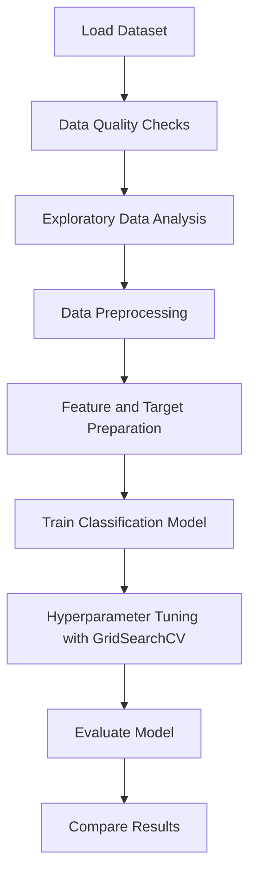

# 📊 Customer Churn Prediction
### Machine Learning | Telco Customer Analytics

<p align="center">
  <strong>Turning customer data into insights for better retention decisions.</strong>
</p>

<p align="center">
  
  
  
  
  
</p>

---

## 🎯 Project Overview

Customer churn occurs when customers discontinue a company's services. Identifying customers who may leave helps businesses understand customer behaviour and develop better retention strategies.

This project uses the **Telco Customer Churn dataset** to explore customer information, prepare data, train a classification model, and evaluate its performance before and after hyperparameter tuning.

## ✨ Project Highlights

- 📂 Data loading and quality checks
- 🔍 Exploratory data analysis (EDA)
- 🧹 Data preprocessing and feature preparation
- 🤖 Machine learning classification
- ⚙️ Hyperparameter tuning using `GridSearchCV`
- 📈 Model evaluation and performance comparison

## 📁 Dataset

**Dataset:** Telco Customer Churn  
**Source:** [Kaggle — Telco Customer Churn](https://www.kaggle.com/datasets/blastchar/telco-customer-churn)

The dataset contains customer demographics, subscribed services, account details, billing information, and churn status.

| Attribute | Description |
|---|---|
| Input features | Customer, service, account, and billing information |
| Target variable | `Churn` |
| Prediction task | Binary classification |
| Target classes | `Yes` — churned, `No` — did not churn |

## 🔄 Project Workflow



## 📈 Model Results

The notebook reports the following accuracy scores:

| Model | Accuracy |
|---|---:|
| Original model | 73.81% |
| Tuned model | 73.81% |

> **Key observation:** Hyperparameter tuning did not improve the reported accuracy in this experiment. Further evaluation is needed to determine whether other metrics or modelling approaches provide better churn detection.

Accuracy alone does not show how effectively a model identifies customers who actually churn. Precision, recall, F1-score, and a confusion matrix are useful additional measures.

## 🛠️ Technology Stack

| Technology | Purpose |
|---|---|
| Python | Programming language |
| Pandas | Data manipulation |
| NumPy | Numerical operations |
| Matplotlib | Data visualization |
| Seaborn | Statistical visualization, if used |
| Scikit-learn | Model training, evaluation, and tuning |
| Google Colab | Notebook execution |

## 🚀 Getting Started

### 1. Clone the repository

```bash
git clone https://github.com/tanush090/Customer-Churn-Prediction-ML.git
cd Customer-Churn-Prediction-ML
```

### 2. Install dependencies

```bash
pip install -r requirements.txt
```

### 3. Download the dataset

Download the [Telco Customer Churn dataset from Kaggle](https://www.kaggle.com/datasets/blastchar/telco-customer-churn).

Place the CSV file in your working directory or update the file path in the notebook.

### 4. Run the notebook

Open `Customer_Churn_Prediction_ML.ipynb` in Jupyter Notebook or upload it to [Google Colab](https://colab.research.google.com/).

Run the cells in order.

## 🔮 Future Improvements

- Improve recall for customers who churn.
- Explore class imbalance handling where appropriate.
- Compare Logistic Regression, Random Forest, and other classifiers.
- Perform additional feature engineering.
- Evaluate models using ROC-AUC and precision-recall metrics.
- Use cross-validation for more robust model comparison.
- Investigate model interpretability to understand churn drivers.

## 👨‍💻 Author

**Tanush Kumar**  
B.Tech — Computer Science and Engineering (AI & ML)  
Graduation Year: 2028

---

<p align="center">
  <em>Built as a machine learning project to explore customer behaviour and churn prediction.</em>
</p>
